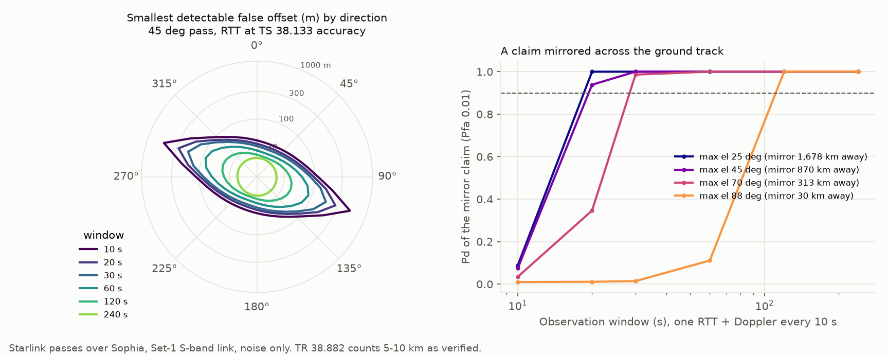
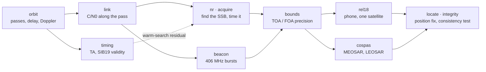

# ntn-pass

[](https://github.com/vdesmond/ntn-pass/actions/workflows/ci.yml)

This "project" touches on a variety of topis, in particular whether satellites can tell where a transmitter is from the delay and Doppler of its signal alone? and some implications on it.

We will have two systems of note:

- **5G NR non-terrestrial networks (Rel-18):** We have a phone that reports its own GNSS position. The network has to check that report against the round-trip time and Doppler it sees through one satellite, because
  regulation and emergency calls depend on the phone's location!
- **COSPAS-SARSAT:** We have a distress beacon sending short bursts at 406 MHz. A ground station (MEOLUT) has to find it from the bursts' time and frequency of arrival, relayed by Galileo satellites.

Both systems rest on the same physics. A satellite pass imprints a delay and a Doppler shift on the signal,
and both depend on where the transmitter is. 

So in this project, I try to build this "chain" from orbits through
the radio link to a position fix. We try to the best we can to calculate the numbers from real TLE snapshots (Starlink, OneWeb,
Galileo) and the 3GPP and COSPAS-SARSAT documents, cited by version and clause wherever applicable.

## Results

To the primary question we raised in the introduction?

Yes. To about 100 m or better for a phone tracked over a minute, and within a few kilometres for a
distress beacon heard once. However, the catch is that we have the transmitter's mirror image across the satellite's ground
track.

A satellite's delay and
  Doppler are nearly symmetric about its ground track, only being broken by Earth rotation and track curvature. In the systems of note, we see the following consequences.
  - **Rel-18:** There are false claims under a kilometre off which are caught within 10 s, far inside TR 38.882's 5–10 km. A claim at the mirror point passes, though, and that point is 30–1,700 km away, often in another country. Rejecting it for the system takes 20–30 s of measurements, or 120 s on a near-overhead pass. More
    measurements in the same window don't necessarily help, only a longer window does.
  - **LEOSAR:** We have one satellite listening to a beacon over a pass. Once the beacon's allowed frequency drift is estimated (ignoring it biases the fix by 0.2–2.9 km), one pass rejects the mirror only
    30 to 70% of the time, and almost never on an overhead pass. This is why single-pass systems report both candidate positions!

In **MEOSAR**, four Galileo satellites relay the
  same burst. This one burst has a unique fix! Over a day, the solver was started 1,344 times
  from each satellite's mirror point and from rings up to 3,000 km out. We see that every run either returned to the beacon or stopped somewhere the consistency test rejects with certainty. A ground station that only just meets the COSPAS-SARSAT accuracy specification still puts 98.2% of single first-generation
  bursts within 5 km over a day (90.6 % at the worst moment, against the 90 % required).
  The second-generation beacons reach 100%!



## Structure

We have the following links in the chain largely acting a semi self-contained study, and built in dependency order:

| Study                              | Question                                                                        | Note                                                                                                                                                                                                          |
| ---------------------------------- | ------------------------------------------------------------------------------- | ------------------------------------------------------------------------------------------------------------------------------------------------------------------------------------------------------------- |
| [passes](docs/passes.md)           | What does a pass look like from the ground?                                     | Starlink: 22.5 ppm Doppler (45 kHz at 2 GHz) with 6-minute passes. 178/h is always taking the highest satellite, until it sets, keeping each at 15.7                                                          |
| [link](docs/link.md)               | How strong is the signal along a pass?                                          | The handheld S-band downlink swings 11 dB over one Starlink pass (TR 38.821 Set-1), so a fixed margin either wastes most of the pass or loses its edges.                                                      |
| [timing](docs/timing.md)           | How long does the broadcast timing assistance stay good?                        | SIB19 validity is limited by the feeder link, not the ephemeris. We see 20 s on Starlink, 45 s on OneWeb, against 120–180 s for the ephemeris alone.                                                          |
| [acquisition](docs/acquisition.md) | Can the phone find the cell, and how precisely does one SSB time the satellite? | Acquisition under ±45 kHz of Doppler is down to −6.2 dB per resource element and 9 dB below the pass edge. Note that one SSB measures range to 0.8–2.7 m and range rate to 3–11 m/s, at the Cramér-Rao bound. |
| [beacon](docs/beacon.md)           | How well can a distress beacon be heard and timed through Galileo?              | Every compliant beacon we have clears the MEOLUT sensitivity. Second-generation beacons time 45× better than first-generation ones, until the repeater's ~100 ns group-delay uncertainty takes over.          |
| [locate](docs/locate.md)           | Where is the transmitter, and can a false claim be caught?                      | The answer above.                                                                                                                                                                                             |



Please note that some results are contextual rather than actual links in the above described chain! For example, the Ka-band and uplink budgets, the OneWeb
cases and HARQ/K_offset sizing. They are computed and verified, and kept in the study pages.

## Methodology

- **Spec tables are reproduced (where they can be):** Examples are TR 38.821's maximum RTTs and link
  budgets, TR 38.811's Doppler limits and COSPAS-SARSAT T.019's uplink budget.
- **Mismatches are recorded:** Where we have a printed table that can't be reproduced from its own
  inputs, a strict `xfail` test records the mismatch.
- **Estimators are held against their bounds:** The SSB estimator and the position solver both reach
  their Cramér-Rao bounds in Monte Carlo tests. The location consistency test hits its predicted
  false-alarm rate and noncentrality.
- **The orbit chain is cross-checked against Skyfield:**: within 5 cm in range and 1 mm/s in range rate.
- **Assumptions are labelled:** The study page says which value was used and why.

## Run

```sh
uv sync
uv run pytest                    # offline: uses the committed TLE snapshot
uv run ntn-pass all              # every study in dependency order
uv run ntn-pass locate           # one study -> results/locate.json, figures/locate-*.png
uv run ntn-pass passes --site toulouse
```

## Layout

`src/ntn_pass/` is a library of modules!

| Role        | Modules                                                                                                                               |
| ----------- | ------------------------------------------------------------------------------------------------------------------------------------- |
| Orbits      | `tle` (snapshots), `frames`, `sites`, `orbit` (propagation, look geometry, passes), `analytic` (the TRs' closed forms), `serving`     |
| Link        | `link`: TR 38.821 parameter sets, plus the 406 MHz repeater budget                                                                    |
| Signals     | `nr`: numerology, NTN broadcast fields, SS/PBCH block and channel; `beacon`: FGB/SGB waveforms and schedules                          |
| Measurement | `acquire`: SSB search and fine TOA/FOA estimator; `bounds`: Cramér-Rao bounds for any waveform                                        |
| Systems     | `timing`: Rel-17 TA and SIB19; `rel18`: what NR location verification measures; `cospas`: what MEOSAR/LEOSAR measure and must achieve |
| Position    | `locate`: model, solver and CRB; `integrity`: consistency test, detectable offset, mirror search                                      |

## Glossary

|                |                                                                                         |
| -------------- | --------------------------------------------------------------------------------------- |
| NTN            | Non-terrestrial network: 5G NR served through satellites (3GPP Rel-17 onwards)          |
| SSB            | SS/PBCH block: the synchronisation signal a phone acquires first (PSS + SSS + PBCH)     |
| SIB19          | System information block carrying the satellite ephemeris and timing-advance assistance |
| TA, RTT        | Timing advance; round-trip time                                                         |
| TOA, FOA       | Time and frequency of arrival of a burst                                                |
| CRB            | Cramér-Rao bound: the lowest error variance any unbiased estimator can reach            |
| SNR per RE     | Signal-to-noise ratio per resource element (one subcarrier for one OFDM symbol)         |
| MEOSAR, LEOSAR | COSPAS-SARSAT search and rescue through medium / low Earth orbit satellites             |
| MEOLUT         | The ground station that tracks MEOSAR satellites and locates beacons                    |
| FGB, SGB       | First- / second-generation 406 MHz distress beacons (C/S T.001 / T.018)                 |

## License