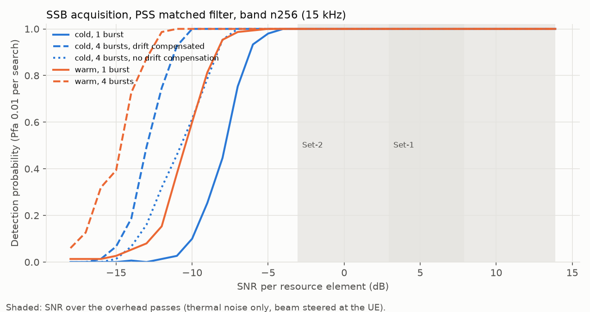
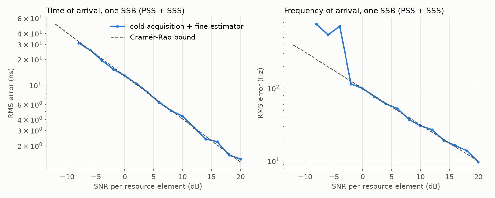
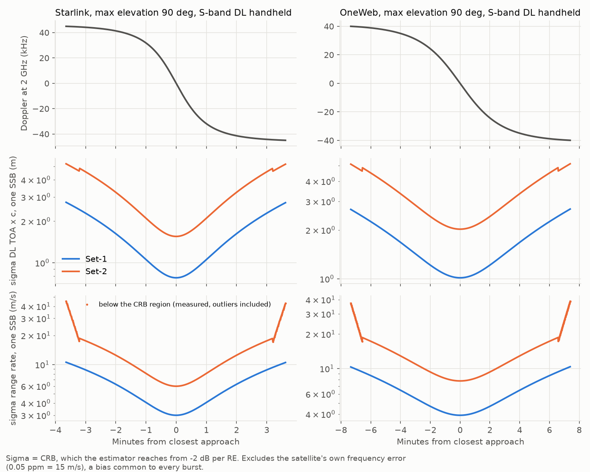

# Acquisition: finding the cell, and what one SSB measures

[← back to the overview](../README.md) · Code: `nr` (SSB, channel), `acquire` (search, fine estimator), `bounds` · study `studies/acquisition.py` · `uv run ntn-pass acquisition` (~3 min) → `results/acquisition.json`, `figures/acquisition-*.png`

The UE's first contact with an NTN cell is the SS/PBCH block, and the downlink arrives with the full
service-link Doppler. TS 38.300 V17.6.0 §16.14.2.2 leaves the feeder-link Doppler to the network and the
service link to the UE, and the UE has no ephemeris before it has read SIB19, which comes after the SSB.
Once it has acquired the cell, the same SSB gives a time and frequency of arrival per burst. Those are the
UE-side delay and Doppler measurements that Rel-18 network-verified location uses ([locate](locate.md)).

Setup:
- band n256 (S-band), SSB at 15 kHz, Case A (TS 38.101-5 V17.5.0 Table 5.4.3.3-1); one SSB every 20 ms,
  the periodicity a UE assumes for initial cell selection (TS 38.213 V17.7.0 §4.1); carrier 2 GHz as
  everywhere else (n256 DL is 2,170–2,200 MHz, so Hz values there are ~9 % higher);
- PSS and SSS on subcarriers 56–182 of the block (TS 38.211 V17.6.0 Table 7.4.3.1-1) with the raster
  at subcarrier 120 (TS 38.101-1 V17.11.0 Table 5.4.3.2-1), i.e. k = −64…62. The sequences come from the
  floating-point reference of [nr-cell-search](https://github.com/vdesmond/nr-cell-search), which found
  the same −64 against a real capture;
- channel: the transmitted OFDM signal is evaluated at each sample's emission time t − τ(t), with τ(t) the
  pass's delay. The envelope delay, its drift and the carrier Doppler all come from the same τ(t), with
  no interpolation. Added on top: the satellite access node's frequency error (±0.05 ppm, TS 38.108
  V17.5.0 §6.5.1.2), a random phase and white noise;
- SNR per resource element = the [link](link.md) CNR (the carrier power is spread evenly, so every RE sees the
  same SNR). The PSS adds 21 dB of processing gain (127 tones) on top;
- the UE oscillator is GNSS-disciplined (an NR NTN UE has GNSS), so the absolute Doppler is observable.

Two searches, each at a total false-alarm probability of 1 %:
- **cold**: no ephemeris. ±(24 ppm + 0.05 ppm) in 5 kHz steps (21 hypotheses; 24 ppm is the
  TR 38.811 LEO-600 maximum), 20 ms of timing, 3 N_ID2: 4.8 million cells.
- **warm**: valid SIB19 and GNSS position (connected mode, or idle with a stored SIB19). The UE
  pre-compensates the Doppler and the delay. What is left is the two-body ephemeris error ([timing](timing.md): under
  12 Hz at 120 s) plus the 0.05 ppm satellite error, so one frequency hypothesis and ±1 symbol of
  timing: 1,644 cells.

## Acquisition

| Search | SNR per RE for 90 % detection |
| --- | --- |
| cold, 1 burst | −6.2 dB |
| cold, 4 bursts, drift compensated | −11.1 dB |
| cold, 4 bursts, no drift compensation | −8.3 dB |
| warm, 1 burst | −8.4 dB |
| warm, 4 bursts | −12.8 dB |

- **Thermal noise does not limit acquisition on these links.** Over an overhead pass the S-band handheld
  downlink stays above 2.9 dB per RE with Set-1 and above −3.1 dB with Set-2. That leaves 9 dB and
  3 dB of margin over a cold single-burst search. A 3 dB moving-beam edge and inter-beam interference at
  frequency reuse 1 are not in that budget, and they would use up the Set-2 margin.
- **Bursts can only be combined if the delay drift is removed.** At LEO the arrival time drifts by up
  to 22 µs/s, about 1.7 samples between bursts 20 ms apart at 3.84 MHz. Summing 4 bursts as they come
  gains 2.1 dB instead of 5. Each frequency hypothesis already implies its delay drift (τ' = −f/fc),
  so removing it costs nothing.
- **Ephemeris is worth 2.2 dB in detection**, all of it from searching 3,000 times fewer cells at the same
  false-alarm rate, and it removes the 21-hypothesis frequency search.
- **The detection statistic matches theory.** At the true lag with no offset, 2T follows a noncentral
  chi-square with 2K degrees of freedom and noncentrality 254·K·SNR. That puts the warm single-burst
  90 % point at −8.35 dB; the full Monte Carlo gives −8.38 dB. With 4 bursts the Monte Carlo is 0.5 dB
  short of the aligned value (−12.8 vs −13.2 dB), which is the cost of fractional-sample timing and the
  residual frequency offset.

## Accuracy of one SSB

After acquisition the cell identity is known, so the PSS and the SSS both serve as references. The fine
estimator FFTs both symbols, searches the timing offset globally, takes the frequency from the PSS→SSS
phase step and refines both jointly. It also resolves the 7 kHz ambiguity of that phase step by testing the
three wraps. Its model includes the envelope compression by the Doppler (τ' = −f/fc): leaving that out
biases the estimates by 0.7 ns and 0.4 Hz on Starlink.

- The Cramér-Rao bound for one SSB (254 known tones, unknown amplitude and phase) is
  σ_τ = 1 / (2π B_rms √(2·254·SNR)), with B_rms = 549.9 kHz for the 127-tone PSS, and
  σ_f = 1 / (2π T_sym √(508·SNR)) from the two symbols 2 T_sym apart.
- **The estimator reaches the bound from −2 dB per RE** for both TOA and frequency, and for TOA alone
  from −8 dB. Below −2 dB about 1 % of bursts take the wrong 7 kHz wrap, and those outliers dominate the
  frequency RMS. SNRs where fewer than 50 of the 200 trials were detected (−10 and −12 dB) are not
  plotted, because their RMS would rest on a handful of samples.

## Along the passes (S-band DL handheld, one SSB)

| | σ DL TOA × c | σ range rate | share below −2 dB |
| --- | --- | --- | --- |
| Starlink overhead, Set-1 | 0.78–2.74 m | 3.0–10.6 m/s | 0 |
| Starlink overhead, Set-2 | 1.55–5.22 m | 6.0–45 m/s | 12 % |
| OneWeb overhead, Set-1 | 1.01–2.69 m | 3.9–10.4 m/s | 0 |
| OneWeb overhead, Set-2 | 2.02–5.12 m | 7.8–39 m/s | 11 % |

`results/acquisition.json` also has the 30° passes.

- **The satellite's own frequency error is larger than the per-burst noise.** TS 38.108 allows
  ±0.05 ppm, which is 100 Hz at 2 GHz, or 15 m/s of range rate. That exceeds σ for every Set-1 burst
  (3–10.6 m/s) and is common to all bursts from that satellite. Treated as unbiased it would mislocate the
  UE, so [locate](locate.md) estimates it as a carrier-offset nuisance parameter.
- **The same offset biases the timing drift.** TS 38.108 requires the same source for the RF frequency and
  the data clock, so the 0.05 ppm also enters the downlink timing drift that Rel-18 can report. The
  verification modelled in [locate](locate.md) uses RTT rather than the timing drift, so the offset only
  enters its Doppler rows.
- **What [locate](locate.md) takes from here**: the per-SSB FOA bound as the Doppler noise, and the TOA bound
  for its SSB-only RTT case. On Set-1 passes the SNR never drops below −2 dB, where the estimator stops
  reaching the bound; on Set-2 passes 11–12 % of bursts do, where about 1 % of bursts take the wrong 7 kHz
  wrap. A fit on those would need the outliers gated, not the inflated RMS; that case is not modelled.
  - **The SSB TOA is one leg of the RTT.** Rel-18 measures round-trip time (UE Rx−Tx plus gNB Rx−Tx), and
    the SSB gives only the UE's downlink-receive leg. The main RTT case in [locate](locate.md) therefore
    uses the TS 38.133 accuracy requirement instead.

## Verification (`tests/test_acquire.py`, `test_bounds.py`)

- **Layout**: an 18-sample CP at 3.84 MHz (from the TS 38.211 CP formula), PSS/SSS on block subcarriers
  56–182, B_rms equal to the closed form for 127 contiguous tones, 1,008 distinct SSS sequences.
- **Noise-free recovery**: with a fractional delay, ±7 km/s range rate, a Doppler rate and up to 1.2 kHz
  of extra offset, the chain finds the right N_ID2 and lag, and the fine estimates agree with the true
  τ(t) and Doppler within 0.2 ns and 0.2 Hz.
- **CFO loss**: the matched filter output follows the energy-weighted phasor sum over the replica, about
  3.9 dB (|sinc(½)|) at half a subcarrier.
- **Threshold**: the noise-only statistic is Exp(1) per cell (mean and 1 % tail), so the Gamma(K)
  threshold holds.
- **Drift compensation**: at 22 ppm, four compensated bursts give more than 0.95 × 4 times one burst's
  peak, and uncompensated bursts give less than 0.85 × 4.
- **Efficiency**: at 10 dB per RE, the normalised error over 400 trials lies inside the chi-square(800)
  99.9 % interval of the CRB.
- **Detection probability**: Monte Carlo Pd at the true lag matches the noncentral chi-square value
  within a 99.9 % binomial interval, at −9 and −8 dB (1 burst) and −13 dB (4 bursts).

Known approximations: single path in vacuum (no multipath, fading, ionospheric delay or phase noise);
thermal noise only, with its variance known to the detector; PBCH as random QPSK; one SSB per burst
(Case A at ≤ 3 GHz allows up to 4 per half frame, for beam sweeping); the cold-search threshold
spreads the false-alarm probability over correlated cells, which makes it conservative.
