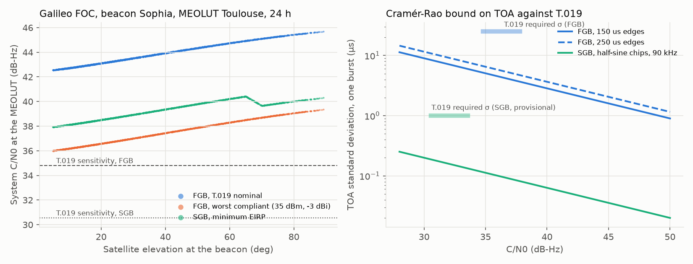

# Beacon: the 406 MHz distress link and how precisely a burst can be timed

[← back to the overview](../README.md) · Code: `beacon` (waveforms, schedules), `link` (406 MHz terms), `cospas` (floors, T.019), `bounds` · study `studies/beacon.py` · `uv run ntn-pass beacon` → `results/beacon.json`, `figures/beacon-link.png`

The [locate](locate.md) study finds a COSPAS-SARSAT distress beacon from one burst received by several
satellites (MEOSAR, as a MEOLUT does), or from the Doppler curve over one LEO pass. Their measurement
noise comes from the 406 MHz link, built here from the COSPAS-SARSAT documents: C/S T.001 Issue 4
Rev.7 (first-generation beacons, FGB), T.018 Issue 1 Rev.7 (second-generation, SGB), T.016 Issue 1 Rev.5
(MEOSAR payloads) and T.019 Issue 2 Rev.5 (MEOLUT specification). These are the March 2021 issues;
newer revisions exist (T.018 is at least at Rev.13), and they may settle T.019's bracketed SGB values.

Chain: beacon at Sophia Antipolis → Galileo FOC repeater → MEOLUT at Toulouse. Satellites count only when
both ends see them at ≥ 5° (T.019 Annex F). The repeater is a bent pipe, so
(C/N0)sys = 1 / [(C/N0)up⁻¹ + (C/N0)dn⁻¹ + (C/N0)im⁻¹] (T.019 Annex A).
- **Uplink** (T.019 Table A.2 structure): beacon EIRP minus free-space loss at 406.05 MHz, a 3 dB
  linear-to-circular polarisation loss and 2.5 dB of fading, plus the satellite G/T. For G/T this uses the
  measured Galileo FOC values (T.016 Table 4.3: −15.3 dB/K at the edge of coverage, −13.6 at the centre,
  interpolated in off-nadir angle) rather than T.019's −12.7 example.
- **Downlink**: at least 17.8 dBW of FOC EIRP at 1544.1 MHz, of which one beacon gets a share 10 dB lower
  (T.019: 8 signals plus noise). Fading is 2.5 dB and local losses 1 dB.
  - The MEOLUT G/T is design dependent (T.019 §A.5). 4 dB/K is an assumption. The same value appears in a
    published SGB link study, seen only through a search summary.
- **Intermodulation**: C/I3 = 28 dBc (T.016), spread over the 90 kHz passband against one beacon's share,
  giving 67.5 dB-Hz. That is negligible either way.
- **Beacons**:
  - FGB at T.019's nominal 7 dBW with a 2 dBi antenna;
  - FGB worst compliant: 35 dBm with a −3 dBi antenna (T.001 limits);
  - SGB at the T.018 Table 2.5 minimum EIRP (33–34 dBm).

## Results over 24 h

Six to 13 Galileo satellites are in view of both ends (9.4 on average). T.019 lets a MEOLUT track as
many as it has antennas, four in its own example.

| Beacon | Uplink C/N0 | System C/N0 | TOA, one burst: CRB / with satellite floor | FOA, one burst: CRB / with satellite floor |
| --- | --- | --- | --- | --- |
| FGB, T.019 nominal | 43.1–46.6 dB-Hz | 42.5–45.7 dB-Hz | 1.5–2.1 / 1.5–2.1 µs | 5–8 / 7–9 mHz |
| FGB, worst compliant | 36.1–39.6 dB-Hz | 36.0–39.4 dB-Hz | 3.1–4.5 / 3.1–4.5 µs | 11–17 / 12–17 mHz |
| SGB, minimum EIRP | 38.1–40.7 dB-Hz | 37.9–40.4 dB-Hz | 0.06–0.08 / 0.12–0.13 µs | 4–5 / 6–7 mHz |

The satellite floors come from T.016 and differ per satellite, so the emission-time and carrier
unknowns in [locate](locate.md) can't absorb them:
- **TOA, 101 ns**: the repeater group-delay uncertainty (< 163 ns at 95 %, 83 ns at 1σ) combined with its
  3-minute stability (< 200 ns peak-to-peak, taken as uniform).
- **FOA, 4.6 mHz**: the translation oscillator (4×10⁻¹² over 100 ms at 1.138 GHz).

For the SGB the TOA floor exceeds the link CRB. Real MEOLUTs reduce these terms by calibrating against
reference beacons.

One more term needs calibration: the group delay also slopes with frequency (2.5 µs per 4 kHz on FOC).
Across the SGB's ±1.2 kHz carrier tolerance that is up to ±0.75 µs. It is fixed for a given satellite and
frequency (characterised per C/S R.018), so it is assumed calibrated; left uncalibrated, it would be
comparable to the 1 µs requirement.

- **The uplink sets the system C/N0.** The downlink gives each beacon 51.6–53.4 dB-Hz at 4 dB/K. These
  numbers follow T.019's convention of a fixed 10 dB share per beacon: the downlink then costs 1.2 dB for a
  nominal FGB and less for weaker beacons. With level control on a noise-loaded repeater, a weak beacon
  also gets a smaller share, so the real downlink penalty is closer to equal across beacons.
- **Every compliant beacon clears the T.019 sensitivity** (34.8 dB-Hz FGB, 30.55 dB-Hz SGB) at every
  geometry. The worst-compliant FGB at 5° lands at 36.0 dB-Hz, inside the 34.8–37.8 dB-Hz band where
  T.019 specifies the accuracy, so that band is the low-margin case.
- **The SGB is about 45 times better in TOA** at equal C/N0, because its information is in the chip edges
  (38,400 chips/s; rms bandwidth 17.8 kHz after the 90 kHz passband). An FGB has only the ±1.1 rad
  biphase transitions at 400 bps with 150–250 µs edges (rms bandwidth 0.4–0.55 kHz). The waveforms
  follow T.001 and T.018:
  - FGB: 160 ms of carrier, then a 144-bit long message starting with the 15-bit sync and frame sync
    `000101111`.
  - SGB: half-sine OQPSK chips, one of T.018's listed filters, over a 1 s burst.

  A slow-edged FGB has a bound about 30 % larger than a fast-edged one.
- **The CRB is well below what T.019 requires**. At the sensitivity level:
  - FGB TOA: 5.2 µs (150 µs edges) or 6.6 µs (250 µs edges), against 25 µs required.
  - SGB TOA: 0.19 µs, against [1] µs required (provisional).
  - FOA, both beacons: about 0.02 Hz, against 0.2 Hz required.

  The gap is implementation margin plus what the link CRB leaves out. For FOA, that is mainly the
  beacon oscillator: T.001 allows a residual frequency variation of 3×10⁻⁹, which is 1.2 Hz at 406 MHz.

## What the locate study uses

Two noise cases per beacon type:
- **T.019-compliant**: σ_TOA = 25 µs and σ_FOA = 0.2 Hz (FGB), or [1] µs and [0.2] Hz (SGB, provisional).
  Any commissioned MEOLUT meets these.
- **Link-limited**: the CRB from each satellite's own system C/N0 combined with the satellite floors above,
  so σ differs per satellite.

For **meosar**, every satellite hears the same burst within tens of milliseconds. The beacon's oscillator
error is therefore common to all copies and the carrier nuisance absorbs it. Repeater group-delay
uncertainty (< 163 ns at 95 %, T.016) is negligible for an FGB but 15 % of the SGB requirement. The
Galileo translation-frequency error (< 10⁻¹²) is negligible.

For **leosar**, one satellite hears bursts 47.5–52.5 s apart (T.001), so the oscillator error is *not*
common:
- The residual variation (3×10⁻⁹ = 1.2 Hz) is a per-burst noise floor about 60 times the link CRB.
- The allowed mean slope (1×10⁻⁹ per minute) adds a 4 Hz drift over a 10-minute pass, which a constant
  carrier nuisance cannot absorb.

There is no LEOSAR payload document in the sources (C/S T.003 could not be retrieved). The single-pass
case therefore reports a requirement instead of a budget: for a worst-compliant FGB to reach 34.8 dB-Hz
at 5° on the 485 km stand-in pass (2,037 km slant range), the payload needs a G/T of at least −39.5 dB/K.
The Starlink pass stands in for a real LEOSAR orbit.

The missing payload document doesn't change the single-pass answer:
- Above the sensitivity level, the beacon oscillator's 1.2 Hz per-burst floor is about 60 times the FOA
  CRB (0.019 Hz), so σ_FOA is the same at any C/N0.
- The required −39.5 dB/K is far below any receive G/T a satellite would fly, so the uplink doesn't limit.

## Verification (`tests/test_beacon.py`, `test_bounds.py`, `test_cospas.py`, 406 MHz part of `test_link.py`)

- **T.019 Table A.2, Galileo uplink**: 45.7 dB-Hz reproduces from the table's own inputs, including its
  173.7 dB path loss. The 5° slant ranges reproduce: Galileo to the printed kilometre, GLONASS and GPS
  within 10 km. T.016's 1.9 dB horizon-to-zenith path difference also reproduces.
- **T.019 Table A.1 (downlink) does not close**: the printed 185.4 dB path loss should be 185.27 dB at
  28,350 km and 1544.1 MHz, and the table's own inputs sum to G/T − Lo + 20.7, not the printed + 23.7.
  Both are strict `xfail` tests. The downlink here is computed from T.016 instead.
- **Worst-compliant FGB**: at 5° it lands inside T.019's 34.8–37.8 dB-Hz accuracy band.
- **Numerical CRB**: matches the closed forms (FOA from burst length and energy, TOA from rms bandwidth)
  within 5 %. It stays below the T.019 requirement at the sensitivity level for FGB (both edge times) and
  SGB, and grows with the FGB edge time.
- **FGB waveform**: 520 ms long, constant envelope, unmodulated for the first 160 ms, ±1.1 rad peak,
  sync header as in T.001.

Known approximations: the 406 MHz waveform's 10–90 % edge time is taken on a linear phase ramp; SGB chips
are pseudo-random rather than T.018's PRN segments (which matter for acquisition, not for the bound);
data-aided estimation over the whole burst; no repeater gain suppression from interference (T.019 §A.2:
up to 30 dB for 10–100 ms); free-space propagation with the T.019 nominal fading margin.
