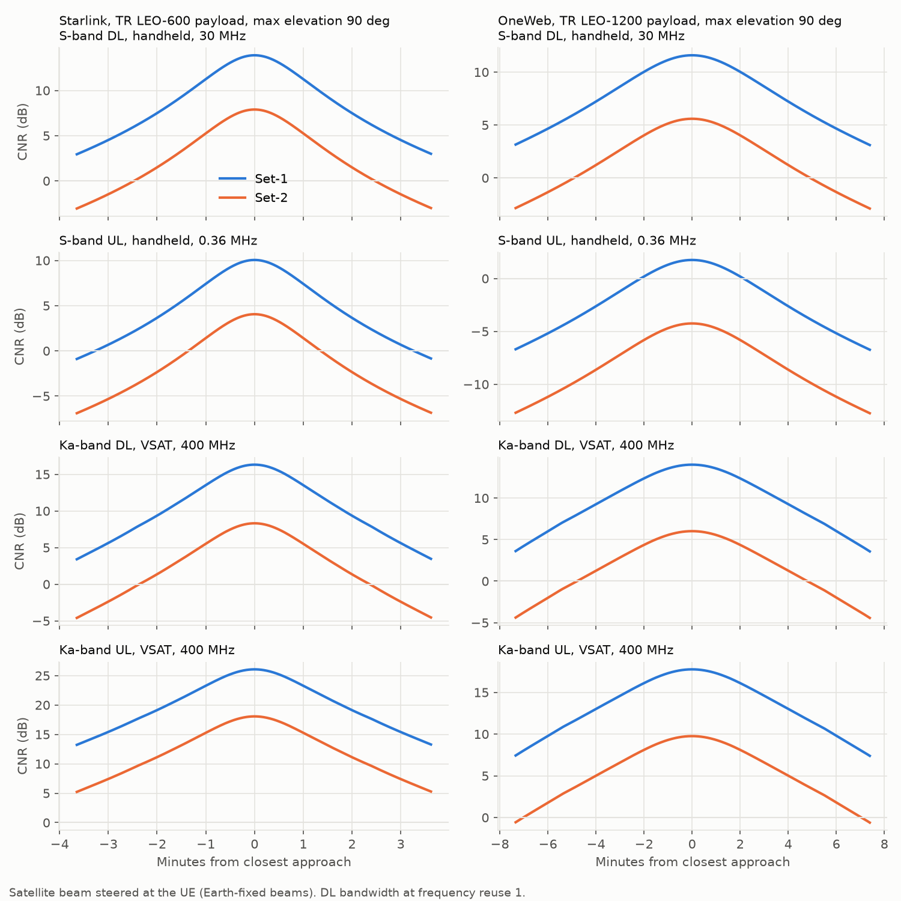

# Link: how strong the signal is along a pass

[← back to the overview](../README.md) · Code: `link` · study `studies/link.py` · `uv run ntn-pass link` → `results/link.json`, `figures/link-cnr.png`

CNR along each pass with TR 38.821 V16.2.0 eq. 6.1.3.1-2. The payload (Set-1 / Set-2, Tables 6.1.1.1-1/-2)
and terminal (Table 6.1.1.1-3: S-band handheld, Ka-band 60 cm VSAT) parameters stay fixed. The
elevation-dependent terms are recomputed for every sample:
- free-space loss from the real slant range;
- gaseous absorption, ITU-R P.676 Annex 2 with the P.835 reference atmosphere (TR 38.811 §6.6.4,
  computed with ITU-Rpy);
- scintillation: 2.2 dB ionospheric in S-band, which is the TR's baseline margin for regions of maximum
  scintillation. TR 38.811 notes strong scintillation is rare at mid-latitudes, so for Sophia this is
  pessimistic. In Ka-band, the TR 38.811 Table 6.6.6.2.1-1 tropospheric values, interpolated linearly
  between the 10° steps, which causes the small kinks in the Ka curves;
- shadowing margin: 3 dB for the handheld.

The satellite beam is assumed steered at the UE (Earth-fixed beams, scenarios C1/D1). `beam_edge_loss_db`
adds the loss for a UE at a moving-beam edge.

The S-band downlink CNR here is the per-resource-element SNR the [acquisition](acquisition.md) study
works at. The UL and Ka-band rows are context: nothing downstream uses them.

The TR has payloads only for 600 and 1,200 km. They are applied to the nearest real constellation:
LEO-600 on Starlink and LEO-1200 on OneWeb. Starlink actually flies at ~466 km, so its CNRs are
~2 dB better than at the TR's geometry.

## Results over Sophia Antipolis, overhead pass (10° → 90°), Set-1

| | Starlink (LEO-600 payload) | OneWeb (LEO-1200 payload) |
| --- | --- | --- |
| S-band DL, handheld, 30 MHz | 2.9 → 13.9 dB | 3.1 → 11.6 dB |
| S-band UL, handheld, 360 kHz | −0.9 → 10.1 dB | −6.7 → 1.8 dB |
| Ka-band DL, VSAT, 400 MHz | 3.4 → 16.3 dB | 3.6 → 14.0 dB |
| Ka-band UL, VSAT, 400 MHz | 13.2 → 26.1 dB | 7.4 → 17.8 dB |

Set-2 is 6–8 dB lower throughout. Over one pass the CNR swings by about 11 dB on Starlink and 8.5 dB
on OneWeb, so a fixed link-budget margin either wastes most of the pass or loses its edges.
`results/link.json` also has a 30° pass and C/N0 for every link.

## Verification (`tests/test_link.py`)

- **Every input column** of TR 38.821 Table 6.1.3.3-1 is reproduced to its printed precision, for all
  20 LEO cases (SC6–SC15, SC21–SC30). The columns are EIRP, terminal G/T, FSPL, gaseous loss and
  scintillation. The handheld G/T (−31.6 dB/K) is derived from gain, noise figure and antenna temperature.
  The VSAT G/T (15.9 dB/K) is not an independent check: the TR doesn't give the 20 GHz receive gain, so
  the aperture efficiency (0.6) is fitted to it. The TR conflicts with itself here. Its 43.2 dBi Tx gain
  implies an efficiency of 0.587, which would give G/T 15.83. With 0.587 the 600 km Ka DL rows would land
  on the printed values and the 1,200 km rows would still miss, so the xfail list below depends on this
  choice.
- **End-to-end CNR** matches the TR exactly in 26 of the 40 DL/UL entries. In the other 14 (every Ka-band
  DL row, plus SC7/SC22 UL), the TR's own printed inputs give a CNR 0.05–0.09 dB above the printed
  result. For example, SC6 DL inputs give 8.58 dB but the TR prints 8.5. The printed values look
  truncated rather than rounded. These 14 are strict `xfail` tests, and ours differ from the TR's inputs
  only by input precision (G/T 15.94 vs 15.9).
- **Gaseous loss**: Annex 2 (the TR's stated baseline) reproduces all the LEO rows at 30°. Only Annex 1
  reproduces the GEO 12.5° row at 20 GHz (1.2 dB; Annex 2 gives 1.13). GEO is not used here.
- **Not reproducible as tabulated**: the S-band UL rows print the bandwidth as "0.4 MHz" but their
  CNRs correspond to 360 kHz, the value in Table 6.1.3.2-1.
