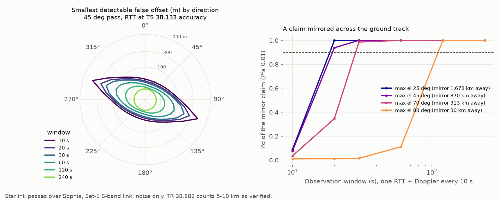
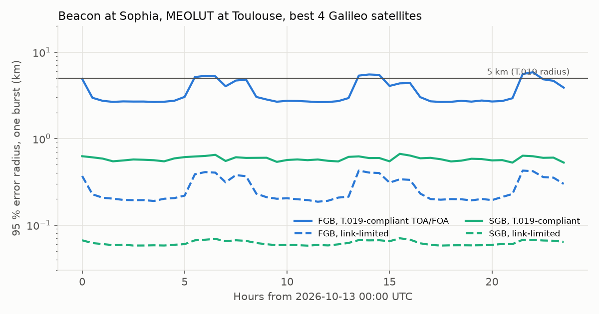

# Locate: where the transmitter is, and whether a claim can be trusted

[← back to the overview](../README.md) · Code: `locate` (model, solver, CRB), `integrity` (consistency test, mirror), `rel18`, `cospas` · study `studies/locate.py` · `uv run ntn-pass locate` (~40 s) → `results/locate.json`, `figures/locate-*.png`

The inverse problem. The solver (`locate`, Levenberg-Marquardt on whitened residuals) estimates the
transmitter's north/east offset at a known height. The nuisance parameters it estimates alongside are an
unknown emission time, a carrier offset and, for the single-pass case, a carrier drift. A χ² consistency
test (`integrity`) checks a *reported* location against the measurements.

`tests/test_locate.py` shows the solver recovers the truth exactly without noise and reaches the
Cramér-Rao bound, and `tests/test_integrity.py` shows the test's false-alarm rate and its noncentrality
under a false report are as predicted, for every measurement set below. The accuracy figures here
therefore come from the CRB of the same model, and a Monte Carlo of the solver itself is reported
alongside.

## NR NTN: verifying a UE-reported location from one satellite (Rel-18)

TS 38.305 V18.8.0 §4.3.11 bases the Rel-18 NTN network verification on Multi-RTT from a single satellite at
several instants plus the UE's downlink timing drift due to Doppler. TR 38.882 V18.0.0 counts a location as
verified within 5–10 km (macro-cell size, enough to tell countries apart).

Setup: Starlink passes over Sophia Antipolis, one RTT and one Doppler measurement every 10 s (an
assumption, Rel-18 leaves the schedule to the location server), consistency test at Pfa 1 %.
- **RTT noise from TS 38.133**: V19.0.0 Table 10.1.25C.2-1 gives the FR1-NTN UE Rx-Tx accuracy as
  ±(59 + δ) Tc at 0 dB, 15 kHz and ≥ 52 PRB, with δ = 80 Tc (Table 10.1.25C.2-2). That is ±71 ns.
  - It is read as a 90 % two-sided bound (an assumption: the table gives a ± limit, not a σ).
  - The network leg (gNB Rx-Tx) has no NTN requirement in the sources and is taken equal.
  - Result: σ_RTT = 61 ns, or 9 m of range.
  - A second case uses the SSB alone ([acquisition](acquisition.md)'s TOA bound on both legs). It is optimistic for two reasons:
    it is a bound with no implementation margin, while TS 38.133 is a requirement, and it gives the uplink
    leg the downlink SSB's accuracy, while the uplink runs over 360 kHz at lower CNR ([link](link.md)). PRS/SRS
    over 52+ PRBs is wider than the SSB, so bandwidth is not the reason.
- **Doppler noise from [acquisition](acquisition.md)**: the per-SSB FOA bound at each instant's Set-1 SNR,
  which is inside the region where the estimator reaches it. The satellite's 0.05 ppm frequency error is estimated as a
  carrier offset. It would otherwise bias the result by 15 m/s.

| Pass max elevation | 10 s window | 60 s | 240 s |
| --- | --- | --- | --- |
| 25° | 31–572 m | 21–123 m | 15–28 m |
| 45° | 40–517 m | 27–88 m | 21–22 m |
| 70° | 83–377 m | 57–67 m | 19–47 m |
| 88° | 360–824 m | 64–480 m | 18–229 m |

These are the smallest false offsets detected with 90 % probability, best to worst direction. Adding a 10 m
range floor for troposphere, ionosphere and ephemeris bias raises them by about half. That floor is added
as white noise. A real bias is correlated across the window: it does not average down, and it raises the
false-alarm rate for truthful UEs.

- **Small offsets are easy to detect.** Even two measurements 10 s apart detect a false claim under a
  kilometre off in every direction, far inside TR 38.882's 5–10 km. The detection region is an
  ellipse elongated across the satellite's track, and it shrinks as the window grows.
- **The weakness is the mirror image across the ground track.** One satellite's delay and Doppler are
  nearly symmetric about its ground track. Only Earth rotation and track curvature break the symmetry.
  - The figure's right panel searches for the near-mirror point that best explains the true
    measurements, and gives the probability that a claim there is rejected.
  - With a 10 s window that probability is under 10 % on every pass. A UE could claim a location
    1,678 km away (25° pass) or 870 km away (45° pass), in another country, and pass.
  - It takes 20 s of measurements to reject the mirror on low passes, 30 s at 70°, and 120 s on a near-overhead pass, where the
    mirror is only 30 km away.
  - **Time-to-verify is set by the mirror, not by the noise.** It depends on the window length, not
    on the number of measurements. With one pair every 1 s instead of every 10 s (11 pairs in 10 s),
    the mirror still passes 80–99 % of the time in a 10 s window. The 20 s and 120 s thresholds barely
    move.
- **Threat model.** The UE reports its own Rx-Tx and downlink Doppler, so a UE that knows its true position
  can falsify them. The test catches a wrong or spoofed GNSS fix and naive false claims, not a fully
  adversarial UE. Only gNB-measured quantities resist that.

## MEOSAR: one distress burst through Galileo

Beacon at Sophia, MEOLUT at Toulouse, satellites at ≥ 5° from both (T.019 Annex F). At most four
satellites are used, as for a MEOLUT with four antennas, chosen for the smallest position CRB (T.019's
minimum-JDOP rule). The 406 MHz noise comes from [beacon](beacon.md) in its two cases (T.019-compliant σ and
link-limited σ per satellite). Evaluated every 30 min over 24 h against the T.019 §5.6 requirements for
nearly-static beacons.

| | Single burst within 5 km (T.019: FGB ≥ 90 %, SGB ≥ 95 %) | 95 % radius, one burst (median / worst) | Later fixes |
| --- | --- | --- | --- |
| FGB, T.019-compliant | 98.2 % mean, 90.6 % worst epoch | 2.9 / 5.9 km | 10 min (13 bursts): 100 % within 5 km |
| FGB, link-limited | 100 % | 0.21 / 0.43 km | |
| SGB, T.019-compliant | 100 % | 0.59 / 0.67 km | 5 min (16 bursts): 100 % within 1 km |
| SGB, link-limited | 100 % | 0.06 / 0.07 km | |

- **T.019's TOA/FOA requirements are just enough for its location requirement** in the worst geometry: a
  MEOLUT that only meets 25 µs / 0.2 Hz still puts 90.6 % of single FGB bursts within 5 km at the worst
  epoch of the day, against the 90 % required.
- **The SGB is about 5 times better at T.019-compliant noise and 3.5 times better link-limited.** The gap
  between compliant and link-limited (10–14×) is implementation margin.
- **One burst has a unique fix.** At every epoch, the solver was started from each used satellite's
  ground-track mirror and from rings 300, 1,000 and 3,000 km out in eight directions, on noise-free data.
  That makes 1,344 starts. 1,304 end at the beacon (compared in ECEF, since the north/east
  parametrisation wraps). The other 40 stop at false minima whose lowest noncentrality is about 218,000,
  so the consistency test rejects all of them. Four satellites in different planes leave no mirror.
- **Solver check**: at one epoch with four satellites, 500 runs of the solver give a 95 % radius of
  2.66 km against the CRB's 2.68 km.
- **Robust to the sampling step**: re-sampled every 5 minutes over the day, the FGB T.019-compliant
  single-burst worst epoch is still 90.6 % within 5 km, with no epoch below 90 %.
- **The multi-burst results treat bursts as independent.** The repeater group-delay floor (T.016) and
  T.019's limit on the bias of the mean ([0.2] µs SGB, 2.5 µs FGB) are fixed per satellite and do not
  average down over bursts. That moves the 5 km and 1 km results by tens to about 100 m. T.019's 100 m
  target at 30 minutes would need it modelled, and is not evaluated here.

## LEOSAR-style: the Doppler curve of one pass

FGB bursts every 47.5–52.5 s (T.001) over Starlink stand-in passes. Per-burst σ_FOA is 1.22 Hz, the T.001
residual frequency variation (3×10⁻⁹), which dominates the link bound by about 60 times.

| Pass max elevation | Bursts | Error semi-axes (drift estimated) | Mirror rejected (drift estimated) | Bias if the drift is ignored |
| --- | --- | --- | --- | --- |
| 25° | 8 | 0.15 × 0.37 km | 35 % | 0.24 km |
| 45° | 8 | 0.10 × 0.25 km | 69 % | 0.22 km |
| 70° | 9 | 0.07 × 0.34 km | 64 % | 0.36 km |
| 88° | 8 | 0.07 × 3.9 km | 1 % | 2.9 km |

- **The beacon's frequency drift has to be estimated.** T.001 allows a mean slope of 10⁻⁹ per minute. Left
  out, it biases the fix by 0.2–0.4 km, and by 2.9 km on an overhead pass.
- **Estimating the drift weakens the ambiguity resolution.** The drift absorbs much of the asymmetry that
  separates the mirror, so the mirror is rejected only 35–69 % of the time from one pass. This is why
  single-pass systems report both candidate positions.
- **An overhead pass gives no cross-track information**: one semi-axis grows to 3.9 km and the mirror is
  only 25 km away.

Known approximations: the satellites are treated as the receivers, so the bent-pipe downlink (known from
the ephemeris) and the repeater translation are not modelled. Other approximations: no light time, a
straight-line path, and noise only. No troposphere, ionosphere or ephemeris bias, except the 10 m floor
case for NR. The stand-in passes are Starlink, not real LEOSAR orbits.
