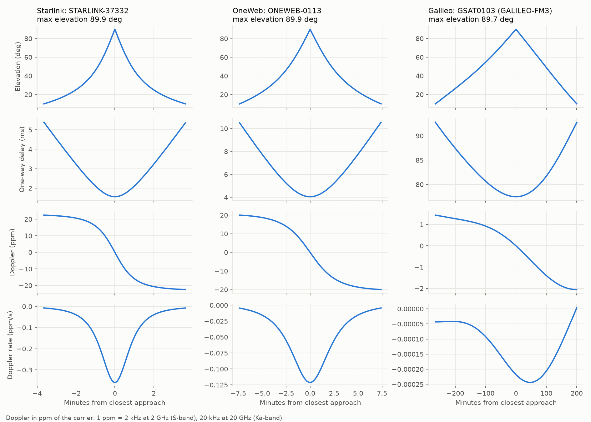
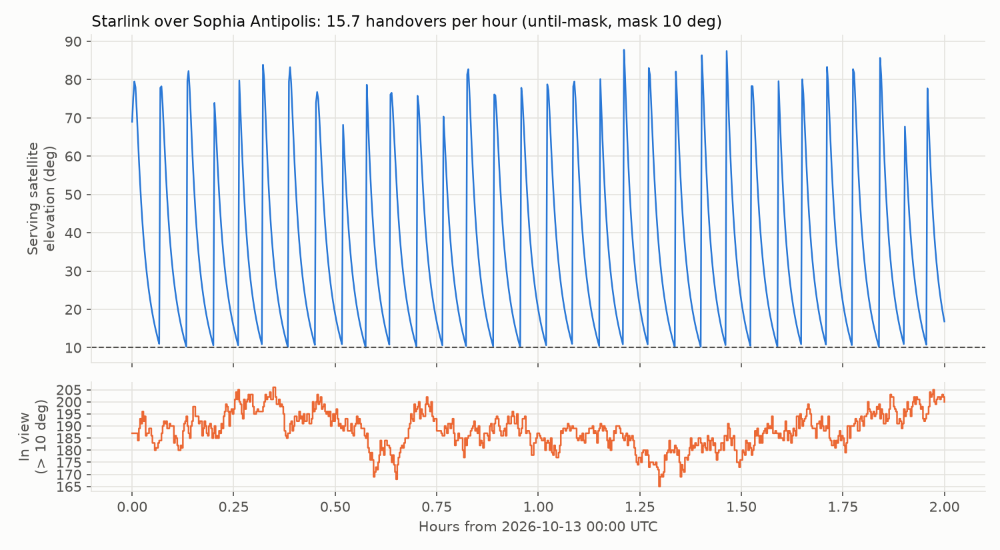
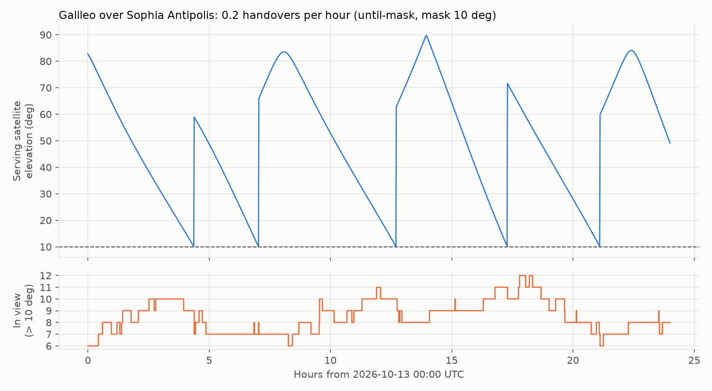

# Passes: what a satellite pass looks like from the ground

[← back to the overview](../README.md) · Code: `orbit`, `serving`, `tle`, `frames` · study `studies/passes.py` · `uv run ntn-pass passes` → `results/passes.json`, `figures/passes-*.png`

`data/tle/` holds one Celestrak snapshot per constellation, fetched 2026-10-13 (`manifest.json`
lists the epochs). Analyses start at 2026-10-13 00:00 UTC, so SGP4 runs within about a day of the
elements and results are reproducible. Each constellation is filtered to operational satellites by
mean altitude, eccentricity and element age:

- **Starlink**: 9,728 of 10,654, in the 440–600 km shells. The median mean altitude is 466 km
  (above the equatorial radius), not the 550 km often quoted. The ~360 km group (orbit raising or very
  low shells) and deorbiting satellites are dropped.
- **OneWeb**: 648 of 651, around 1,200 km.
- **Galileo**: 30 of 32. The two satellites in eccentric orbits (GSAT0201/0202) are dropped.

Chain: SGP4 (TEME) → Earth-fixed frame with GMST82 (the convention SGP4 output assumes) → WGS-84 site
→ azimuth, elevation, range, range rate. Range acceleration is analytic (two-body gravity plus the
centrifugal and Coriolis terms), so the Doppler rate does not depend on the time step.
Doppler = −fc·ṙ/c, positive while the satellite approaches.

## Results over Sophia Antipolis (10° mask)

| | Starlink | OneWeb | Galileo |
| --- | --- | --- | --- |
| Satellites in view (min / mean / max) | 165 / 196 / 230 | 20 / 26 / 36 | 6 / 8.5 / 12 |
| Mean pass duration (complete passes in the window) | 6.2 min | 11.5 min | 5.4 h |
| One-way delay, overhead pass | 1.56–5.39 ms | 4.05–10.55 ms | 77.5–92.8 ms |
| Max Doppler, overhead pass | 22.5 ppm (45 kHz at 2 GHz) | 20.0 ppm | 2.1 ppm |
| Max Doppler rate, overhead pass | 0.36 ppm/s | 0.12 ppm/s | 2.4·10⁻⁴ ppm/s |
| Handovers/h, highest satellite always | 178 | 31.5 | 0.46 |
| Handovers/h, highest + 5° hysteresis | 144 | 29.1 | 0.42 |
| Handovers/h, keep until it sets | 15.7 | 8.3 | 0.21 |

The handover rate depends entirely on the selection policy, so the policy is always reported with the
number. "Highest satellite always" on Starlink switches every few tens of seconds. That is a bound,
not a policy anyone would run. The median dwell (20 s) is at the 10 s grid resolution.
Delay drift in µs/s equals Doppler in ppm (both are ṙ/c).

## Verification (`tests/test_analytic.py`, `test_orbit.py`, `test_crosscheck.py`)

- **TR 38.821 V16.2.0 Table 4.2-2** (10° minimum elevation, spherical Earth 6,371 km): the max slant
  range (40,581 / 1,932 / 3,131 km) and every max RTT (541.46, 270.73, 25.77, 41.77, 12.89, 20.89 ms)
  reproduce to the TR's printed precision. Service-link-only values correspond to Scenario B/D. Adding
  an equal feeder link gives Scenario A/C.
- **Max Doppler**: the closed form (TR 38.811 §5.3.4.4, UE in the orbital plane, no Earth rotation)
  gives 23.05 / 20.37 / 19.21 ppm at 600 / 1,200 / 1,500 km. The tabulated 24 / 21 / 20 ppm appear to be
  these values rounded up to the next integer ppm, and the tests assert exactly that. At 10,000 km it
  does **not** reproduce: TR 7.5 ppm (15 kHz at 2 GHz), model 6.41 ppm.
- **Max Doppler rate** (at zero Doppler, overhead pass): TR 38.811 Table 5.3.4.3.2-7 matches at
  1,500 km (180 Hz/s at 2 GHz; model 182) and 10,000 km (6 Hz/s; model 6.3). It does **not** reproduce at
  600 km (TR 544 Hz/s = 0.272 ppm/s, model 581 Hz/s = 0.291 ppm/s) or at 1,200 km in TR 38.821
  (TR 0.13 ppm/s, model 0.123). The two misses go in opposite directions, so it is not a constant or
  a convention. These three misses are kept as strict `xfail` tests, so a later fix shows up.
- **Independent cross-check against Skyfield** (same SGP4 core, but independent time scales, frames and
  topocentric code): on the highest and lowest pass of each constellation, agreement is within 0.05 m
  in range, 10⁻⁵° in elevation/azimuth and 1 mm/s in range rate. That holds once Skyfield's
  UT1 − UTC (0.09 s) is passed in. Without it, the expected difference is ~50 m per 0.1 s at LEO, too
  loose to catch a frame-convention error. Using GAST instead of GMST alone would be ~0.5 km off.
- **Pass finder**: rise/set at the mask to within 10⁻³°, range rate at closest approach within 1 m/s,
  Doppler positive → zero at closest approach → negative, decreasing monotonically.
- **SGP4 envelope**: every sampled Starlink/OneWeb pass stays inside the circular-orbit bounds for delay
  and Doppler, with margins for Earth rotation and the ellipsoid.
- **Analytic Doppler rate** vs the numerical derivative of the range rate: within 0.5 % of the peak.

Known approximations: UT1 = UTC by default (pass `dut1_s`), polar motion neglected, vacuum
propagation (no ionosphere/troposphere delay), J2 left out of the range acceleration only.
