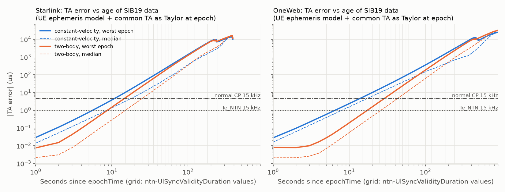
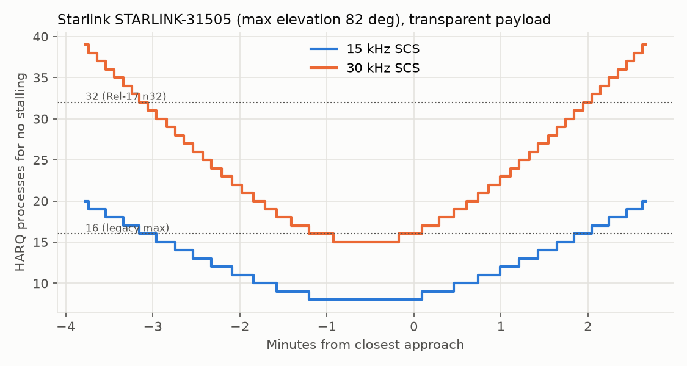

# Timing: how long the broadcast timing assistance stays good

[← back to the overview](../README.md) · Code: `timing`, `nr` · study `studies/timing.py` · `uv run ntn-pass timing` → `results/timing.json`, `figures/timing-*.png`

Rel-17 NR NTN (TS 38.211 V17.11.0 §4.3.1, TS 38.213 V17.14.0 §4.2, TS 38.321 V17.15.0,
TS 38.331 V17.18.0 SIB19 / NTN-Config). The uplink timing advance is the sum of two parts:
- **UE-specific part**: the service-link round trip, which the UE computes from its own position and the
  broadcast ECEF state of the satellite (quantised to 1.3 m and 0.06 m/s).
- **Common part**: the round trip from the satellite to the uplink time-synchronisation reference point
  (RP), sent as ta-Common, ta-CommonDrift and ta-CommonDriftVariant. The UE turns these into
  Delay_common(t) = TA_C/2 + Drift/2·Δt + Var/2·Δt².

Setup: UE at Sophia Antipolis, a transparent payload, the gateway at Toulouse (an assumed site) with the
RP there. Only times when both ends see the satellite at ≥ 10° are used, over 12 passes per
constellation. N_TA (closed-loop commands) and N_TA,offset are left out.

## How long the SIB19 data stays usable

For every 10 s along each pass the network broadcasts new assistance information. The UE then uses it
for up to 900 s. The resulting TA error is measured against the SGP4 truth and compared with two limits:
- **Te_NTN** (TS 38.133 V17.23.0 Table 7.1C.2-1, 0.94 µs at 15 kHz). This bounds the UE's transmit timing
  against its own computed TA, so the propagation error has to share it with the UE implementation.
- **The normal cyclic prefix** (4.69 µs at 15 kHz). This is what the gNB absorbs without
  inter-symbol interference.

The table gives the largest `ntn-UlSyncValidityDuration` value that holds at every epoch:

| UE propagates the ephemeris with | Network fills TA-Info by | Starlink: Te_NTN / CP | OneWeb: Te_NTN / CP |
| --- | --- | --- | --- |
| constant velocity | either | 5 s / 10 s | 5 s / 10 s |
| two-body (Kepler) | Taylor expansion at the epoch | 5 s / 10 s | 15 s / 25 s |
| two-body (Kepler) | least-squares fit over the validity window | **20 s / 40 s** | **45 s / 60 s** |
| two-body, UE-specific part only (RP at the satellite) | — | 120 s (Te_NTN) | 180 s (Te_NTN) |

- **The feeder-link common TA is the binding term, not the ephemeris.** TA-Info can only describe the
  feeder delay as a quadratic, and the feeder range of a LEO satellite has a large third derivative.
  A Taylor expansion at the epoch is off by microseconds within 5–15 s.
- **Fitting the quadratic over the window the network intends to cover** triples to quadruples the validity, and
  placing the RP at the satellite removes the common term altogether.
- **Constant-velocity extrapolation is unusable** beyond the 5 s minimum: gravity bends the track by
  hundreds of metres within 10 s.
- **The same ephemeris error leaves a Doppler pre-compensation error** after 60 s of about 3 kHz at 2 GHz
  for constant velocity, but only about 5 Hz for two-body. That residual sizes the warm search in
  [acquisition](acquisition.md).
- **ta-CommonDriftVariant is unsigned** (INTEGER 0..28949), so the encoder clamps negative curvature to 0.
  The feeder range acceleration stayed positive at every epoch sampled (0 of 1,337 clamped).

## Scheduling offsets and HARQ (an aside)

| | Starlink (RP at gateway) | OneWeb (RP at gateway) |
| --- | --- | --- |
| UE-gNB RTT over the passes | 7.3–21.8 ms | 16.5–42.2 ms |
| cellSpecificKoffset (worst UE and gateway both at 10°, highest satellite) | 25 slots | 43 slots |
| largest K_offset this UE actually needs (rest via Differential Koffset MAC CE) | 22 | 43 |
| kmac if the RP is moved to the satellite (feeder round trip) | 12 | 22 |
| HARQ processes for no stalling, 15 kHz (median / max) | 15 / 22 | 29 / 43 |
| share of the pass where 16 / 32 processes suffice, 15 kHz | 69 % / 100 % | 0 % / 61 % |
| HARQ processes for no stalling, 30 kHz (median / max) | 29 / 44 | 58 / 85 |
| single-UE duty cycle with 32 processes, 30 kHz | 0.97 | 0.59 |

The RTT here is also what Rel-18 location verification measures ([locate](locate.md)). HARQ and
K_offset are consequences of it that nothing downstream uses.

HARQ is counted as N = ⌈RTT / T_slot⌉. TR 38.821 §6.1.1.3 attributes that sizing to one source's
simulations and is not a requirement. A processing-time term is available as a parameter.
On OneWeb, even Rel-17's 32 processes cover only 61 % of the pass at 15 kHz and none of it at 30 kHz.
Beyond that, the remedies are disabling HARQ feedback per process (`downlinkHARQ-FeedbackDisabled`) or
accepting stop-and-wait.

## Verification (`tests/test_timing.py`)

- **TA-Info round trip**: encoding at the epoch and decoding with the TS 38.213 formula reproduces the
  delay and its first two derivatives within each field's granularity, including the factors of 2 between
  the one-way Delay_common and the round-trip fields. A mutation check confirms that dropping either
  factor makes the tests fail.
- **TR 38.821 Table 4.2-2 worst cases fit the TS 38.331 ranges**: the GEO feeder round trip (270.73 ms) fits
  ta-Common; the LEO-600 transparent RTT (25.77 ms) gives K_offset 26; the GEO RTT (541.46 ms) gives
  K_offset 542 ≤ 1023; the GEO feeder RTT gives kmac 271 ≤ 512.
- **Ephemeris fields**: every operational Starlink, OneWeb and Galileo state fits the position and
  velocity code ranges.
- **Two-body propagation from an ECEF state**: TS 38.331 says ECI and ECEF coincide at epochTime. A
  circular test orbit lands where the inertial rotation and Earth rotation put it, within 1 mm.
- **HARQ**: TR 38.821's RTT = 32 ms at 15 kHz gives 32 processes.
- **Reference-point choice**: RP at the gNB versus at the satellite (feeder delay moved into kmac) leaves
  the UE-gNB RTT (TA + kmac, TS 38.321) unchanged up to kmac's 1 ms rounding.
